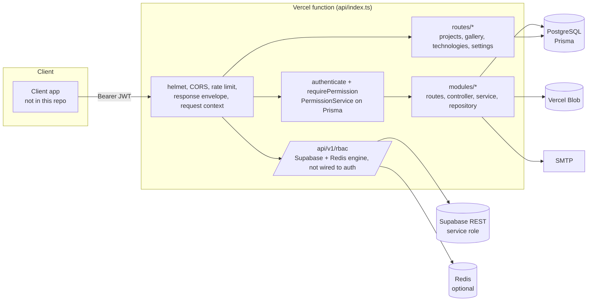

# Application review: Zellavora Control Center

|                      |                                                                                                   |
| -------------------- | ------------------------------------------------------------------------------------------------- |
| Reviewed             | 2026-10-16                                                                                        |
| Commit               | `1557a76` (branch `main`)                                                                         |
| Previous review      | 2026-10-04, commit `6518866`. Status of each earlier finding is in section 9.                     |
| Scope                | `apps/backend` (Express + Prisma), root workspace config, CI workflow, deployment config          |
| Not in scope        | `apps/zcc-frontend`. It is not present in this repository (last touched in `ac5028d`, 2026-10-07) |
| Module documentation | [docs/modules/README.md](../modules/README.md)                                                    |

## 1. Summary

ZCC is a multi-tenant admin platform: identity and access management (IAM), a maker-checker user-request workflow, freelancer timesheets and invoices, a CMS and blog, a media library, organization themes, analytics and operations tooling. The backend is an Express API on Prisma/PostgreSQL that runs as a single Vercel function.

Since the 2026-10-04 review, the most serious structural problem was fixed: the legacy `/api/v1/admin/*` API, which let any signed-in member write users, was deleted. The dashboard was tenant-scoped. The audit read path was moved behind a permission.

Several Critical and High security problems are still open. Most are cheap to fix:

- **Three endpoint groups need no sign-in.** Organizations (read, create, rename, disable 2FA), notifications (read any tenant's, send to a hard-coded address), and the storage upload that writes to disk.
- **Permission checks ignore role status, deny rules and group-granted roles** (`PermissionService`). Disabling a role does not remove access.
- **The IAM user directory is not scoped to the caller's organization.** A `users:read` holder in one tenant can list every tenant's users.
- **The audit-log write endpoint accepts any `organizationId`** from the request body.

The repository also cannot pass CI as configured, and the backend test suite has 4 failing tests. The root `package.json` declares a frontend workspace that is no longer in the repo.

Fix the Critical and High items in section 4 first. Most are a guard, a deleted route, or a value taken from the token instead of the body.

### Scorecard

| Area               | Rating      | Notes                                                                                                                                      |
| ------------------ | ----------- | ------------------------------------------------------------------------------------------------------------------------------------------ |
| Security           | Needs work  | Strong auth core (sessions, MFA, refresh rotation). Three unauthenticated groups and a permission engine that ignores roles' status and groups |
| Architecture       | Good        | Consistent module pattern across 38 modules. Legacy `routes/` layer is smaller but still mounted; the unwired RBAC engine remains            |
| Code quality       | Good        | `tsc --noEmit` passes. Backend lint does not run (see H7)                                                                                  |
| Tests              | Fair        | 519 of 523 pass. 10 modules have no spec. No test asserts that a route rejects anonymous callers                                           |
| CI/CD              | Broken      | Every job depends on a frontend that is not in the repo, or on Node 20, or on retired actions                                             |
| Performance        | Not assessed| The frontend, which carried the bundle-size findings, is out of scope                                                                      |
| Accessibility / UX | Not assessed| Frontend is out of scope                                                                                                                   |

## 2. What was run

| Check                | Command                                    | Result                                                                                                                                 |
| -------------------- | ------------------------------------------ | -------------------------------------------------------------------------------------------------------------------------------------- |
| Backend type-check   | `npx tsc --noEmit` (apps/backend)          | **Pass** (exit 0)                                                                                                                      |
| Backend tests        | `npx jest --runInBand` (apps/backend)      | **519 passed, 4 failed** of 523. 2 suites fail: `src/routes/api-contract.spec.ts` (3 tests), `src/modules/settings/settings.controller.spec.ts` (1 test) |
| Backend lint         | `npm run lint --prefix apps/backend`       | Not run. The script is `eslint src --ext .ts`, and the root `.eslintrc.json` loads an Angular plugin the backend does not install       |
| Root install         | `npm ci` (root)                            | Not run. The root `package.json` lists `apps/zcc-frontend` as a workspace, and that directory does not exist, so the install is expected to fail (see H7) |
| Frontend checks      | —                                          | Not run. No frontend in the repository                                                                                                 |

The settings failure is a stale test. It expects `{ success, data }` exactly, and the controller now also returns `message`. The api-contract failures were not analysed in this pass beyond their names; the 2026-10-04 review attributed them to the OpenAPI spec drifting from the registered routes.

## 3. Architecture overview

- **Request path.** `api/index.ts` exports the Express app. Middleware order in `app.ts`: static favicon, JSON body (50 MB), response envelope, login decryption, CORS, helmet, auth-surface rate limit, AsyncLocalStorage request context, routes, RBAC gateway, 404, error handler.
- **Route mounting.** `routes/index.ts` (`registerApiRoutes`) mounts every module under `/api/v1/*`, most with a `/api/v1/clean/*` alias. A second tree, `/api/admin` (`modules/admin/admin.routes.ts`) and `/api/app` (`modules/application/application.routes.ts`), re-mounts many of the same routers.
- **Module pattern.** `modules/<name>/` holds `*.routes.ts`, `*.controller.ts`, `*.service.ts`, `*.repository.ts`, `*.dto.ts` (Zod). 38 module directories, 314 TypeScript source files, 44 spec files.
- **Legacy layer.** `routes/projects.ts`, `gallery.ts`, `technologies.ts` and `settings.ts` predate the pattern. They are mounted at the `/api/v1` root, and they validate less.
- **Two permission systems.** `requirePermission` in `middleware/auth.ts` (Prisma role assignments) guards nearly everything. A second engine in `rbac/` (Supabase tables, Redis cache, deny-wins inheritance) is mounted at `/api/v1/rbac`, but nothing sets the `req.auth` it reads (finding M1).
- **Tenancy.** The access token carries the organization (`tid`). Most modules take it from the token. The IAM directory and some public routes do not (findings H5, C1).

## 4. Findings

Severity: **Critical**, exploitable without special access and high impact. **High**, exploitable by any signed-in user or breaks a security boundary. **Medium**, real weakness with limited reach. **Low**, hygiene.

Status is relative to commit `1557a76`. Items marked *Resolved* are verified fixed. *Open* items were re-checked against the code.

### Critical

#### C1. Organization endpoints need no sign-in (Open)

`apps/backend/src/modules/organization/organization.routes.ts`

`GET /api/v1/organizations/:id`, `POST /api/v1/organizations` and `PUT /api/v1/organizations/:id` have no `authenticate` guard and are declared `security: []`. Anyone on the internet can read an organization by id, create organizations, and rename any organization or set `enforce2fa: false` on it. The router is also mounted at `/api/v1/clean/organizations`, and inside the admin tree at `/api/admin`.

**Fix.** Add `authenticate` and a platform-level permission to all three. For update, require `req.tenantId === :id` unless the caller holds the platform permission. Remove the `/clean/` alias.

#### C2. Legacy admin API checks sign-in only (Resolved, with a residual)

The `routes/admin-*.ts` files that wrote users through the Supabase service-role client are gone. The `/api/admin` tree is now guarded by `adminAuthGuard` (`modules/admin/middleware/admin-auth.ts`), and the IAM routers it mounts carry their own `requirePermission` checks.

Residual: `adminAuthGuard` only checks that the caller has a non-empty role. Any member passes it, so the `/api/admin` prefix is not an authorization boundary by itself. Every router it mounts has to enforce its own permission, and C1 breaks that for the organization router.

**Fix.** Require a platform or admin permission in `adminAuthGuard`, not a non-empty role. Delete the `/api/v1/admin/api/Authentication/gettoken` alias with M5.

#### C3. Notification endpoints need no sign-in (Open)

`apps/backend/src/modules/notification/notification.routes.ts`

`GET /api/v1/notifications` and `POST /api/v1/notifications/send` have no guard and are declared `security: []`. The GET lists any organization's notifications. The send route creates notifications for any organization and enqueues a `send-otp` job to the hard-coded address `admin@zellavora.com`, with the request body as the message (`notification.service.ts:30`).

**Fix.** Add `authenticate`, take the organization from the token, and either finish the module or remove it. The frontend-side `broadcast` and `templates` calls from the 2026-10-04 review have no backend counterpart either.

### High

#### H1. JWT secrets fall back to known values (Open)

`apps/backend/src/config/env.ts:45-46`

When `JWT_SECRET` or `REFRESH_TOKEN_SECRET` is unset, the app signs and verifies tokens with `'dev-secret-change-in-production'` and `'dev-refresh-secret'`. On Vercel the app keeps serving with a degraded `/health` rather than failing (`env.ts:209` lists the required variables). A deployment that loses the variable accepts tokens anyone can forge.

**Fix.** In `TokenService`, refuse to sign or verify when the secret is missing, shorter than 32 bytes, or equal to a default. Return 503. Keep the "do not throw at import" behaviour.

#### H2. Unauthenticated upload writes to local disk (Open)

`apps/backend/src/modules/storage/storage.routes.ts` → `storage.repository.ts:18`

`POST /api/v1/storage/upload` has no guard. It decodes up to 50 MB of base64 and writes it under `process.cwd()/scratch/`. Nothing serves that folder, and Vercel's filesystem is read-only, so the route works only as a disk-filling vector on a long-lived host. Path traversal is not possible because the extension cannot contain `..`.

**Fix.** Delete the route. `POST /api/v1/storage/media` is the guarded, tenant-scoped replacement.

#### H3. Any signed-in user can write audit records for any organization (Open)

`apps/backend/src/modules/audit/audit.routes.ts:148`, `audit.controller.ts:100`, `audit.dto.ts:25-26`

`POST /api/v1/audit-logs/log` passes the body to `logActivity`, which trusts `organizationId` and `actorId` from the body. The route is guarded only by `authenticate`. Anyone can plant or impersonate entries in another organization's audit trail, which undermines its value as evidence.

**Fix.** Remove the endpoint. Server code already audits through `infrastructure/audit.ts`. If it must stay, force `organizationId` and `actorId` from the token and require a dedicated permission.

#### H4. Legacy audit read skips the audit permission (Resolved)

The `routes/admin-audit.ts` handlers that returned audit records to any member are deleted. The canonical audit routes (`/api/v1/operations/audit-logs`) are permission-guarded.

#### H5. IAM directory is not scoped to the caller's organization (Open; dashboard half Resolved)

`apps/backend/src/modules/users/iam-user.repository.ts:67`

`IamUserService.list` filters only on `isDeleted: false` and `APPROVED_USER_WHERE`. There is no organization filter, so a user with `users:read` in one organization lists every approved user on the platform. With `users:manage` they can lock any of them (`POST /api/v1/iam/users/:id/lock`) and revoke their sessions. `getById`, `stats` and `lock` follow the same pattern.

The dashboard half is fixed: `modules/dashboard/dashboard.scope.ts` derives scope from verified JWT claims, and the dashboard repository takes it on every method.

**Fix.** Filter through `userTenants: { some: { organizationId: req.tenantId } }` in list, get, stats and every action. Alternatively, declare the IAM directory a platform-operator console and gate it behind a platform permission that tenant admins never receive.

#### H6. Permission checks ignore role status, deny rules and group roles (Open)

`apps/backend/src/services/auth/permission.service.ts`

`PermissionService.loadForUser`, which backs every `requirePermission` call, reads the `allow` rows of the user's direct role assignments and nothing else:

- It never reads role status. A role set to `INACTIVE` keeps granting access to its holders.
- It filters `effect: 'allow'` in the query, so a `deny` on one role cannot cancel an `allow` from another.
- It never loads roles granted through groups (`userGroups → group.groupRoles`). Group-based access grants nothing at runtime. The User Request access preview (`user-request.access.ts`) does count group roles, so approvers see access the user will not get.
- When no codes are found it falls back to matching the user's `role` string against a role name. That fallback is not documented and should not be a grant path.

**Fix.** Filter assignments to `role.status = ACTIVE` and not deleted. Add roles reached through groups. Compute allows minus denies. Remove or document the name fallback. Add unit tests for each case.

#### H7. CI cannot pass as configured (Open, broader than before)

`.github/workflows/ci.yml`, root `package.json`

- **The root workspace references a missing app.** `"workspaces": ["apps/zcc-frontend"]`, and `lint`, `type-check`, `format:check` and `test` all `cd` into or reference `apps/zcc-frontend`. Any root `npm ci` or script run fails.
- **Every job uses Node 20.** Node.js 20 is deprecated as of 2026-10-01 (per Vercel's runtime notice), and the backend `engines` field still allows it. Use Node 24 (current LTS).
- **`backend-test` never installs backend dependencies.** It runs `npm ci` at the root only. The backend's Jest, Prisma and `tsx` are missing, so `npm run test:backend` cannot start.
- **Retired actions.** `actions/upload-artifact@v3` and `github/codeql-action/upload-sarif@v2` fail on GitHub-hosted runners. `codecov-action@v3` and `trivy-action@master` are unpinned.
- **Artifact paths** (`dist/apps/zcc-frontend`) point at a directory that does not exist. `build-backend` uploads `apps/backend/dist`, which is correct.
- **Lint is not wired.** `npm run lint` runs the frontend linter. The backend's `lint` script depends on an Angular plugin the backend does not install.

**Fix.** Remove the frontend workspace and its scripts from the root until the app returns. Set `node-version: '24'`. Run `npm ci --prefix apps/backend` in backend jobs. Bump the artifact and SARIF actions to v4 and v3. Add a working backend lint config. Run CI on `pull_request` for all branches.

### Medium

| ID  | Status | Finding                                                                                                                                                                                                                                                                                                                                                           | Location                                                                                                  | Fix                                                                                                               |
| --- | ------ | ---------------------------------------------------------------------------------------------------------------------------------------------------------------------------------------------------------------------------------------------------------------------------------------------------------------------------------------------------------------- | --------------------------------------------------------------------------------------------------------- | ----------------------------------------------------------------------------------------------------------------- |
| M1  | Open   | `/api/v1/rbac` mounts a second permission engine. Its middleware reads `req.auth`, which nothing in the codebase sets, so guarded routes always fail. Some routes (`/permissions`, `/permissions/groups`) have no guard. The engine is not wired to `authenticate`.                                                                                             | `app.ts` (rbac gateway mount), `rbac/controllers/rbac.controller.ts`, `rbac/middleware/permission.middleware.ts` | Remove the RBAC router and its Supabase/Redis dependency, or wire `authenticate` and map `req.userId/tenantId` to `req.auth`. Keep one engine. |
| M2  | Open   | Mass assignment in legacy handlers: `gallery.ts` passes `req.body` to `.update()`; `technologies.ts` passes `req.body` to `.insert()`, and `POST /technologies` requires only `authenticateToken`, so any member can add global technologies.                                                                                                                  | `routes/gallery.ts:245`, `routes/technologies.ts:67-69`                                                    | Zod allow-lists on both; require `projects:write` for technologies.                                              |
| M3  | Open   | Public health endpoints disclose internals: `/api/v1/health` returns dependency state and error text (for example "BLOB_READ_WRITE_TOKEN is not set"); `/health` returns config errors.                                                                                                                                                                             | `app.ts` (`/health`, `/api/v1/health`)                                                                    | Keep `/health` as status only; move detail behind `OPERATIONS_SYSTEM_HEALTH_VIEW`, which already gates `/operations/health`. |
| M4  | Open   | Global JSON body limit is 50 MB, while media uploads cap at 3 MB and Vercel at 4.5 MB. Large bodies are parsed before auth runs.                                                                                                                                                                                                                              | `app.ts:35-36`                                                                                            | Set ~1 MB globally; raise per route where needed.                                                                 |
| M5  | Open   | CSP allows `'unsafe-inline'` scripts for the whole API to suit Swagger UI. Helmet applies it globally.                                                                                                                                                                                                                                                       | `app.ts` helmet block                                                                                     | Apply the relaxed CSP only under `/swagger` and `/api-docs`.                                                      |
| M6  | Open   | SMTP settings are stored once for the whole platform, but any organization's admin with `settings:manage` can change them, redirecting every tenant's mail.                                                                                                                                                                                                   | `modules/email-settings/email-settings.routes.ts` (guard is `settings:manage`)                            | Require a platform permission, or store SMTP per organization.                                                    |
| M7  | Open   | Duplicate route trees. Each feature is mounted at up to four paths (`/api/v1/x`, `/api/v1/clean/x`, the `/api/admin` tree, `/api/app`). Each mount is another place a guard can be missed, as C1 shows.                                                                                                                                                       | `routes/index.ts`, `modules/admin/admin.routes.ts`, `modules/application/application.routes.ts`          | Keep one canonical path per feature. Announce removal of the aliases with a date.                                 |
| M8  | Open   | Test failures merged to `main` would be invisible until CI is fixed. 4 backend tests fail (section 2).                                                                                                                                                                                                                                                        | `apps/backend/src/routes/api-contract.spec.ts`, `apps/backend/src/modules/settings/settings.controller.spec.ts` | Update the settings test to the current response shape. Reconcile the OpenAPI spec with the routes (section 2).  |
| M9  | Open   | `GET /api/v1/lookups` (DDL dropdowns) has no `authenticate` on any route. Data is reference data, but it confirms the module's existence and the tenant's configured lists to anonymous callers.                                                                                                                                                              | `modules/ddl/ddl.routes.ts` (0 auth references)                                                           | Add `authenticate`, or document it as intentionally public and keep it to static seed types.                    |
| M10 | Not re-verified | Every authenticated request loads the organization's security policy and writes `sessions.last_activity_at` (per the 2026-10-04 review).                                                                                                                                                                                                                                                  | `middleware/auth.ts` (`touchIfActive`)                                                                    | Cache the policy per organization. Update `last_activity_at` at most once a minute.                                |
| M11 | Open   | `POST /api/v1/notifications/send` and `GET /api/v1/notifications` are the same unguarded routes as C3, and the notifications module has no tests.                                                                                                                                                                                                             | `modules/notification/`                                                                                   | Covered by C3. Add a spec when the module is finished.                                                            |

Not re-checked in this pass: M-items about the in-memory settings store (`routes/settings.ts`) and the 2026-10-04 notes on the `/api/v1/auth/clients` listing (L8). Re-verify before relying on them.

### Low

| ID  | Status | Finding                                                                                                                                                                                                                                                      |
| --- | ------ | ------------------------------------------------------------------------------------------------------------------------------------------------------------------------------- |
| L1  | Open   | `/api/v1/admin/api/Authentication/gettoken` (and two sibling aliases) is public and returns random hex. It is harmless as written, but it is an unexplained route and should be deleted.                                                                |
| L2  | Not re-checked | `console.*` used in place of the Winston logger (`infrastructure/logger.ts`).                                                                                                                                                       |
| L3  | Not re-checked | `/api/v1/health` reports queue metrics as hard-coded zeros.                                                                                                                                                                         |
| L4  | Open   | Stale test: `settings.controller.spec.ts` expects an exact `{ success, data }` payload. The controller also returns `message`.                                                                                                               |
| L5  | Open   | Root `package.json` declares `"engines": { "node": ">=18.0.0" }`, but the backend requires `>=20`. Align both to 24.                                                                                                                                  |
| L6  | Open   | `docs/modules/frontend-core.md` and related frontend module docs describe an app that is not in this repository. Mark them as archived or move them.                                                                                                  |
| L7  | Open   | `CLAUDE.md` lists Angular Material and Vite environment variables. The backend `.env.local` uses `VITE_*` names for values the backend reads (for example `VITE_SUPABASE_URL`). Use one naming scheme.                                                  |
| L8  | Open   | Several `legacy` route files at the `/api/v1` root (`routes/projects.ts`, `gallery.ts`, `technologies.ts`, `settings.ts`) still validate less than the module pattern. Migrate them into `modules/`.                                                  |

## 5. Duplication and dead code

| Concern                                  | Implementations                                                                                                                                                     | Recommendation                                                                                       |
| ---------------------------------------- | ------------------------------------------------------------------------------------------------------------------------------------------------------------------- | ---------------------------------------------------------------------------------------------------- |
| Permission evaluation                    | `services/auth/permission.service.ts` (used); `rbac/` engine (unwired, M1)                                                                                          | Keep one. Remove `rbac/` and `/api/v1/rbac`.                                                         |
| Route trees                              | `/api/v1/*`, `/api/v1/clean/*`, `/api/admin/*`, `/api/app/*` (M7)                                                                                                   | One canonical path per feature.                                                                      |
| Settings storage                         | `modules/settings`, `modules/configuration` (both on `common_configurations`), `routes/settings.ts`                                                                 | One configuration service.                                                                           |
| Timesheets                               | `daily-sheets` + `monthly-sheets`, `timesheets`, `invoices` (which reads monthly sheets)                                                                            | Decide whether the daily/monthly sheet workflow and the timesheet workflow are both products.        |
| Legacy routes                            | `routes/projects.ts`, `gallery.ts`, `technologies.ts`, `settings.ts`, plus a portfolio module                                                                       | Migrate into `modules/` or delete.                                                                   |

## 6. Test coverage

Backend modules with no spec file (10): `admin`, `application`, `cms`, `ddl`, `invitation`, `notification`, `organization`, `resources`, `storage`, `teams`. `dashboard` has specs now.

No test asserts that a route rejects anonymous or under-privileged callers. That is why C1, C3, H2 and H3 were not caught.

**Add one cheap, high-value test:** walk the Express router stack and fail when a route outside an allow-list has no `authenticate` or `requirePermission` in its chain. It would have flagged C1, C3 and H2 before they shipped. Keep the allow-list short and reviewed (health, auth login/refresh, public portfolio, public media).

## 7. Strengths worth keeping

- **Auth module.** Enumeration-resistant responses, TOTP MFA with recovery codes, per-account and per-IP rate limits, refresh-token rotation with family revocation on reuse, HS256 pinned on verify, and a session check on every request so logout and revocation take effect at once.
- **Maker-checker IAM.** Account and access changes go through User Requests (draft, submit, approve, provision) with notes, emails, retry and a full event trail. Each step is permission-guarded.
- **Consistent guards in newer modules.** Daily sheets, monthly sheets, timesheets and invoices use `router.use(authGuard)` and per-step `requirePermission`. User Requests guards every route with `can(permission)`.
- **Sheet rules.** Ownership and review rules live in one place (`daily-sheets/sheets.shared.ts`, `timesheets.rules.ts`): only owners edit, only reviewers approve.
- **Tenant-scoped dashboard.** `dashboard.scope.ts` derives scope from verified claims, and individual accounts see only their own data.
- **Validation and errors.** Zod DTOs in `modules/`, one error envelope, Zod issues mapped to field errors.
- **Serverless-aware bootstrap.** Nothing throws at import. RBAC and Redis initialise lazily. `/health` explains misconfiguration.
- **Test base.** 519 backend tests pass, including user-request, timesheet, invoice rendering and sanitizer specs.

## 8. Recommended plan

| Order | Work                                                                                                                             | Effort   |
| ----- | -------------------------------------------------------------------------------------------------------------------------------- | -------- |
| 1     | C1, C3, H2: add `authenticate` to organization and notification routes; delete `storage/upload`                                 | Hours    |
| 2     | H3, L1: delete `POST /audit-logs/log`; delete the `gettoken` aliases                                                              | Hours    |
| 3     | H1: fail closed on missing or default JWT secrets                                                                                | Hours    |
| 4     | H6: fix `PermissionService` (role status, deny, group roles) with unit tests                                                     | 1 day    |
| 5     | H5: tenant-scope the IAM directory and its actions, or move it behind a platform permission                                      | 1–2 days |
| 6     | H7: fix CI (remove the missing workspace, Node 24, backend install, action versions, backend lint)                               | 1 day    |
| 7     | C2 residual: require a permission in `adminAuthGuard`                                                                             | Hours    |
| 8     | Route-guard test from section 6; fix the 4 failing tests (M8, L4)                                                                | Hours    |
| 9     | M1, M7: remove the unwired RBAC engine and the duplicate route trees                                                             | 1–2 days |
| 10    | M2, M3, M4, M5, M6, M9, M10, L5–L8                                                                                               | Ongoing  |

## 9. Status of the 2026-10-04 findings

| ID  | Earlier severity | Status at `1557a76`                                                                                          |
| --- | ---------------- | ------------------------------------------------------------------------------------------------------------ |
| C1  | Critical         | Open                                                                                                         |
| C2  | Critical         | Resolved in form (legacy API deleted); residual in C2 above                                                  |
| C3  | Critical         | Open                                                                                                         |
| H1  | High             | Open                                                                                                         |
| H2  | High             | Open                                                                                                         |
| H3  | High             | Open                                                                                                         |
| H4  | High             | Resolved (legacy audit routes deleted)                                                                       |
| H5  | High             | Open for the IAM directory; dashboard resolved                                                               |
| H6  | High             | Open                                                                                                         |
| H7  | High             | Open, broader (missing workspace, Node 20 deprecated)                                                        |
| M1  | Medium           | Open                                                                                                         |
| M2  | Medium           | Partly open (gallery update and technologies insert still pass `req.body`)                                   |
| M3  | Medium           | Backend `/health` detail disclosure still open. Now **M3** in section 4                                       |
| M4  | Medium           | Open as the 50 MB body limit. Now **M4** in section 4                                                         |
| M5  | Medium           | Global CSP still allows `'unsafe-inline'`. Now **M5** in section 4                                           |
| M6  | Medium           | Open as the platform-wide SMTP settings. Now **M6** in section 4                                              |
| M7  | Medium           | Open as the `/api/v1` alias trees. Now **M7** in section 4                                                    |
| M8  | Medium           | Legacy admin-helper maps went with the legacy API. Removed                                                    |
| M9  | Medium           | Partly resolved: legacy admin API and audit routes removed. The `/api/admin` and `/api/app` duplicates are new  |
| M10 | Medium           | Not re-verified in this pass. Kept as **M10** in section 4                                                    |
| M11 | Medium           | Not re-checked                                                                                               |
| M12 | Medium           | Open as SMTP settings. Same as **M6** in section 4                                                            |
| M13 | Medium           | Frontend-side. Backend portfolio routes now mounted at `/api/v1/portfolio`, so the path mismatch is gone      |
| M14 | Medium           | Frontend-side; out of scope                                                                                  |
| M15 | Medium           | Frontend-side; out of scope                                                                                  |
| L1–L9 | Low            | Not re-checked, except the earlier L8 (`/api/v1/auth/clients`, a public listing). Re-verify before relying on it |

The IDs in section 4 were renumbered in this review. Use section 4's IDs in new tickets and this table only to trace older ones.
